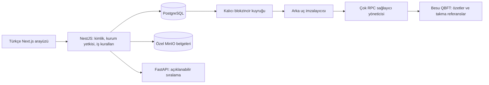
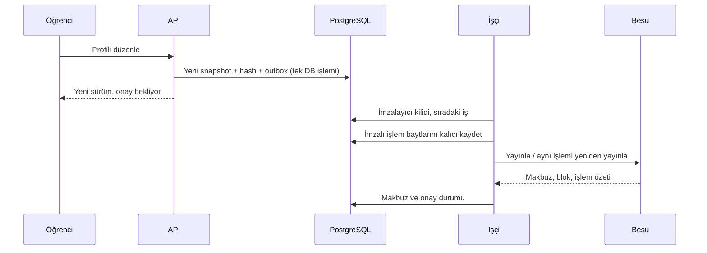

# Mimari

`apps/web`: Next.js App Router, React Hook Form, erişilebilir yerel HTML kontrolleri, Recharts ve QR bileşeni. `src/locales/tr.ts` merkezi durum, alan ve gezinme sözlüğüdür; `html lang=tr`, `tr-TR` tarih/sayı gösterimi kullanılır.

`apps/api`: NestJS REST denetleyicileri, Zod girdileri, Prisma erişimi, HTTP-only oturumlar, kurum kapsamlı yetki kontrolü, kanıt deposu ve outbox işçisi. PostgreSQL normal ekranların operasyonel kaynağıdır. Bütünlük düğmesi canlı sözleşme okuması yapar; sıradan listeler blok taramaz.

`services/matcher`: Pydantic ile izin verilen özellik listesi, deterministik ağırlıklı strateji, isteğe bağlı lojistik regresyon, ayrı sentetik araştırma üretimi. Kimlik, e-posta, biyografi ve hassas nitelikler özellik olarak kullanılmaz. API öğrenci adını hizmete yollamaz.

`packages/contracts`: Solidity 0.8.28, OpenZeppelin AccessControl, London EVM hedefi, Hardhat testleri. `packages/shared`: ortak Zod sözleşmeleri. `packages/demo-data`: çekirdeğin bağımlı olmadığı isteğe bağlı komut paketi.

## Veri ve sürüm sınırları

Kullanıcı, kurum, üyelik, oturum, izin, görünürlük, öğrenci profili, mentor profili, başarı, sürüm, belge, karar, blokzincir kaydı/işi/işlemi, öneri, bağlantı, görüşme, mesaj, bildirim, geri bildirim, denetim, deney ve gösterim partisi ayrı modellerdir.

Öğrenci ve başarı sürümleri ortak `RecordVersion` tablosunda tür ayrımıyla tutulur. İlgiler, beceriler, hedefler ve mentor özellikleri sınırlandırılmış JSON belgeleridir. Bu, değişmez tek belge özetiyle uyuşan pratik bir prototip tercihidir; her özellik için ayrı başvuru tablosu kurulmamıştır. İç kimlikler UUID'dir. `(profileId, version)` ve `(achievementId, version)` benzersizdir. Sürüm yazıları serializable işlemdedir.

PostgreSQL ve blokzincir tek atomik işlem değildir. PostgreSQL işlemi önce tamamlanır; hatalar görünür kuyruk durumlarında kalır. İmzalı işlem baytları sadece arka uçta saklanır, API yanıtlarında döndürülmez. Araştırma doğrudan imzalayıcı kullanırken aynı PostgreSQL kilidini paylaşır.
